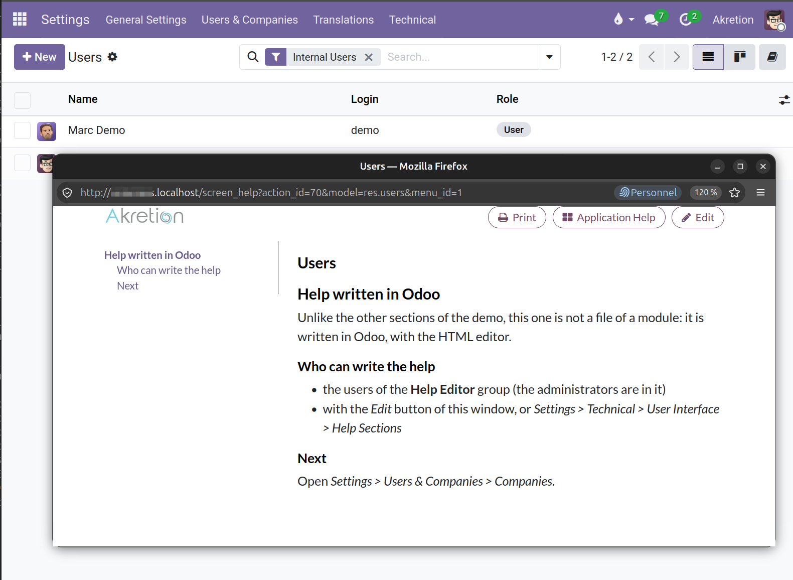
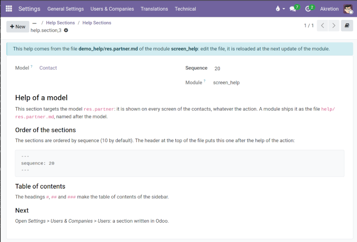
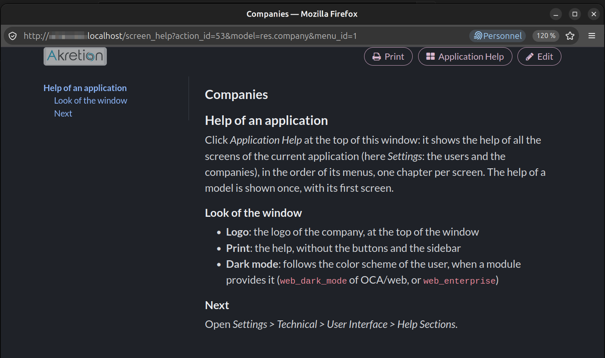

**Read the help**: click the book button of the control panel. The button is
shown when the screen has some help, or to the help editors.

**Write the help in Odoo**: *Edit* button of the help window, then add a
section targeting the action or the model of the screen.



**Ship the help in a module**: add Markdown files in its `help` directory:

```
my_module/help/sale.order.md                     # every screen of the model
my_module/help/sale.action_quotations.md         # one window action (xml id)
my_module/help/sale.action_quotations.fr_FR.md   # in French only
```

An optional header orders the sections (sequence 10 by default). In the
application help, the screens are ordered by the lowest sequence of their
sections, then by the menu order:

```markdown
---
sequence: 20
---
## My help
```

When `screen_help` is installed, the `help` directory of a module is loaded at
each installation / update of the module (and for all the installed modules at
the installation of `screen_help`). Without `screen_help`, it is ignored.

- a section loaded from a file can't be edited in Odoo: edit the file, it is
  reloaded at the next update of the module (its sequence can be changed in
  Odoo meanwhile, the one of the file is applied when the file changes)
- a file removed from the module removes its section at the next update
- the sections of a module are removed when it is uninstalled
- a file whose model or action doesn't exist (module not installed) is ignored
- the headings (`#`, `##`, `###`) make the table of contents of the help window



**Demo**: on a database with demo data, a tour documents each feature on the
screen that shows it, each section pointing to the next screen:

1. contacts, [/odoo/action-base.action_partner_form](/odoo/action-base.action_partner_form)
   (the *Contacts* app doesn't have to be installed): help of an action, of a
   model, of a language, order of the sections
2. *Settings > Users & Companies > Users*: help written in Odoo
3. *Settings > Users & Companies > Companies*: help of an application, look
   of the window
4. *Settings > Technical > User Interface > Help Sections*: help shipped by a
   module



**Migration from `help_popup`** (OCA/web 8.0): the help of the actions
(`enduser_help` and `advanced_help` columns, left in the database) becomes
help sections of these actions, the advanced help under an *Advanced Help*
heading. It happens when `screen_help` is installed, or when it is updated
after renaming the module `help_popup` to `screen_help` (e.g. in the
`renamed_modules` of OpenUpgrade). An action which already has a section
written in Odoo is skipped.
